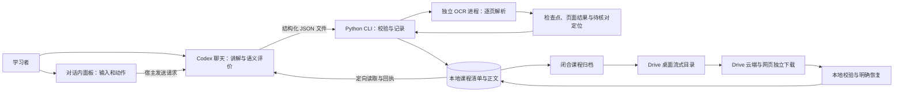
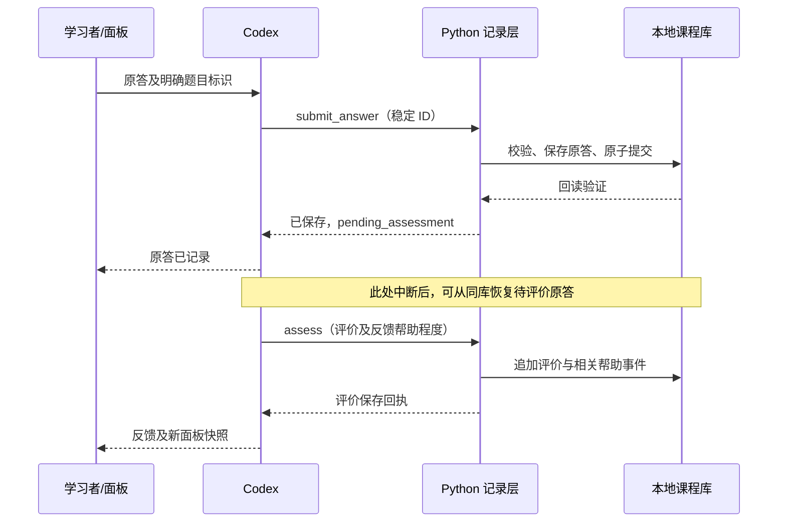

# Codex Learner 项目工程报告

**报告版本：1.1｜报告日期：2026-11-05（北京时间）｜对象：0.2.0 修订候选**

本报告用于项目进度判断、交付评审及后续工程交接。事实依据为指定源码、已有自动化结果、真实模型运行记录，以及用户提供的本机验收报告。建议与尚未实施的优化方向均明确标注，不作为已完成功能。

1.1 版选择性吸收了 Argon 评审中的性能测量和证据留存建议，并纠正了重复去重、缓存完整性及跨平台因果推断。此次为文档与既有证据整理，没有新增产品验收结果；逐项判断见 [评审采纳记录](engineering-review-decisions-2026-11-05.md)。

## 工程结论

Codex Learner 已形成可运行的单人本机学习器：Codex 组织教学与语义评价，Python 保存可核验的课程记录，独立 OCR 进程逐页解析扫描资料，Google Drive 用于历史课程归档。当前工程重点已从“建立核心能力”转向“完成真实使用链路验收、降低操作负担和提交延迟”。

**当前可确认的是：修订代码的自动回归通过；完整交付仍为 PARTIAL，修订包的用户本机复验待完成。** 原候选包的本机 FAIL 结论继续保留，不能被新代码的测试结果覆盖。

| 判断对象 | 当前结论 | 说明 |
| --- | --- | --- |
| 原候选包本机验收 | **FAIL** | 37 项：20 PASS、5 FAIL、12 BLOCKED、0 NOT_RUN；来源为用户提供的报告 |
| 五项实测缺陷的源码修订 | **已完成并通过相应自动回归** | Windows Job 启动时序、HTML 元数据、OCR 基准依赖、样例来源覆盖、归档提示 |
| 修订包跨平台 CI | **PASS** | Windows/Linux、Python 3.10/3.12、独立 OCR 环境和浏览器模拟，共 7 个任务通过 |
| 修订包用户本机定向复验 | **PENDING** | 尚未取得修订包对应的新本机验收报告 |
| 独立聊天恢复待评价 | **原候选 C04 用户报告 PASS** | 原答保真、只追加一次评价；不扩展为原生面板发送或整个版本通过 |
| 默认方案与完整计划交付 | **PARTIAL** | 真实面板、Drive 往返、目标机器默认 OCR 条件等证据仍有缺口 |

项目完成度应按需求、运行条件和验收证据逐项判断。`20/37` 是某个旧包的验收用例统计，不是项目完成率；也不能在修复五处代码后直接将统计改为 `25 PASS`。

## 1. 项目目标与交付标准

### 1.1 项目要解决的问题

普通聊天中的学习内容、原答、反馈和帮助背景容易分散在不同对话中，难以准确续学和复盘。本项目将这些信息保存为用户持有的课程记录，使下一次聊天能够从固定课程库继续，并区分阅读进度、作答表现、帮助条件和真正尚未验证的内容。

核心使用过程为：

**导入资料 → 建立目录与目标 → 分段讲解 → 明确确认或跳过 → 章末练习 → 先保存原答 → 保存评价和帮助 → 复盘与手动复测 → 跨聊天继续。**

项目主要服务单人、单机、多课程学习；用户自行控制节奏，可请求提示、直接看解法、跳章、结束及手动复测。

### 1.2 已确定的运行方案

| 方面 | 当前方案 | 工程含义 |
| --- | --- | --- |
| 开发 | 云端仓库与 CI | 开发环境不自动成为用户本机的安装和课程库 |
| 学习与记录 | 用户本机 Codex、Skill、普通本地磁盘 | 正式记录由 Python 写入固定库，聊天历史不是唯一恢复依据 |
| OCR | 本机独立 CPU 环境、逐页处理 | 不需要服务器；运行时需要足够内存和已校验模型 |
| 活跃课程 | 完整保存在本地 | 本地记录读取不依赖 Drive 在线 |
| 历史课程 | Drive 官方桌面客户端流式目录中的完整归档 | 通过独立取回核验后才允许明确释放本地课程 |
| 存储 | schema 2 小型 JSON 清单＋不可变正文文件 | 不引入 SQLite 或第二套可写学习进度 |

Drive 主要减少长期磁盘占用。运行内存的降低来自逐页处理、独立进程、按需读取和及时退出。

已有课程记录可以通过本地工具离线读取；Codex 的讲解和语义评价仍依赖客户端及模型服务，不能将本地存储描述成整套教学完全离线运行。

### 1.3 完成交付的可观察标志

| 交付面 | 完成标志 |
| --- | --- |
| 学习闭环 | 指定包在真实 Codex 中完成两章教学、六类答案评价、帮助继承、更正、复盘和跨聊天续学 |
| 记录正确性 | 原答逐字一致；同请求重试不重复；重答保留旧答并建立关联；反馈中断后从 pending 恢复 |
| 来源可靠性 | 讲义和评分依据可定位到实际内容；复杂、缺失或无法确认的内容保留待核对状态 |
| 资源 | 日常核心操作达到 256 MiB 初始目标；OCR 在默认 2048 MiB 约束下完成约定样本，超限明确停止并可恢复 |
| 历史归档 | 真实上传、独立网页下载、哈希及内容校验、明确释放、本地完整恢复形成闭环 |
| 安装 | 用户目标 Windows 环境中的安装/升级、实际脚本清单和不同工作目录恢复通过 |
| 证据一致性 | 报告、测试、源码提交、安装清单和 ZIP 哈希能够对应同一交付对象 |

### 1.4 范围边界

当前未承诺多人课堂、多设备并发编辑同一库、独立云端 OCR 服务、自建 Drive OAuth、自动提醒、自动间隔调度、任意格式无限规模导入或所有复杂公式自动准确识别。

教学目标是支持理解与应用。软件正确保存记录，不等于语义评价永远正确，也不证明长期学习效果；长期效果应通过后续延迟复测和新情境表现另行观察。

## 2. 功能现状与完成度

下表同时描述实现状态和证据边界。它是能力矩阵，不是将原 37 项重新分配状态的新版验收表。

| 能力 | 当前实现 | 已有验证 | 尚待完成或限制 |
| --- | --- | --- | --- |
| 课程建立与固定库续学 | 稳定课程 ID、目录、位置及绝对库路径 | 自动回归；旧候选本机恢复报告 | 修订包在目标机器核对安装与固定配置 |
| 资料导入 | TXT、Markdown、HTML、DOCX、PDF；保留原件与定位 | 解析、结构、限额和缺失处理回归 | 复杂资料实际核对；加密、不可读或不支持格式明确失败 |
| 来源核验 | 追加核验事件，可绑定原件及正文哈希 | 哈希失配拒绝、legacy 声明约束 | 标记与哈希不能代替内容语义核查 |
| 两章讲解与阶段门控 | 片段待讲/确认/跳过；末段确认后练习 | 业务、模拟面板；样例引用修订回归 | 修订样例真实教学流程复验 |
| 原答保真与先存后评 | 完整原文先保存，随后追加评价 | 自动回归；用户报告含 CRLF/空格/Unicode 证据 | 修订包定向回归，不篡改旧报告 |
| 重试与重答 | 同 ID 原负载幂等；新 ID 重答关联旧答 | 自动回归和用户本机报告 | 真实面板中操作与回执继续核对 |
| 帮助与评价更正 | 帮助快照、事后补报、评价替代关系、待重评 | 自动回归和用户本机报告 | 教学判断质量需逐题核查 |
| 待评价恢复 | 保存 pending 后新进程/新聊天读取再评价 | 原候选 C04 用户报告通过；修订包跨进程读取通过 | 两类证据分别保留，不外推为所有宿主行为 |
| 历史复盘与手动复测 | 首次、delayed、transfer 分组及真实时间间隔 | 业务回归；历史可回读 | 真正隔日复测尚未取得执行结果 |
| 对话内面板 | HTML 片段快照、明确动作、草稿与请求状态 | 浏览器模拟 18 项通过 | 修订版真实发送、取消、失败恢复证据不足 |
| schema 2 紧凑存储 | 不可变正文、引用回执、按需读取、分页历史 | 保真、坏引用、去重和压力测试 | 元数据仍需载入；写入完整性校验存在 I/O 成本 |
| schema 1 兼容迁移 | 只读兼容、显式预览、旁路迁移和旧字节备份 | 自动回归及用户迁移报告 | 正式库迁移仍需针对选定课程操作 |
| 默认 RapidOCR | PDFium 渲染、逐页识别、选页/裁剪、检查点 | 修订代码真实 Linux 10/100 页；Windows 协议测试 | 用户机器默认内存预检受阻，不能用云端结果替代 |
| Windows OCR 限制 | 原生挂起、Job 成员/限额核验后放行 | 三个 Windows 环境共 27 轮延迟/分配测试 | 修订包目标机器定向复验 |
| 可选 Docling | 明确选复杂页、离线模型、预算失败处理 | 相关协议和防护路径 | 完整模型推理和默认预算适配未验收 |
| 本地归档与恢复 | 闭合 ZIP、传递引用、外部哈希、安全解包、冲突拒绝 | 自动回归；用户报告本地恢复哈希一致 | 本地协议通过不代表真实云盘往返通过 |
| Drive 传输闭环 | 官方流式目录复制、下载声明、校验后明确释放 | 协议回归及恢复提示修订 | 真正上传、网页取回、后续释放链仍待验证 |
| 安装与诊断 | 配置保留升级、备份、独立 OCR 环境、doctor | CI；修订包 Linux 解包安装及清单核验 | 用户暂缓正式 Skill 升级 |
| 可复现打包 | 源码清单、BUILD、ZIP 校验值、允许列表 | 修订包两次构建一致，GitHub 下载回读一致 | 当前为候选附件，非正式长期 Release |

## 3. 系统架构与运行方式

### 3.1 架构与职责

图中的 Drive 云端链路是目标运行流程；本报告不将其画入架构视为已经真实验收。

| 组件 | 负责 | 不承担的职责 |
| --- | --- | --- |
| Codex 与 Skill | 理解学习意图、组织内容、核查来源、评价答案、调用记录工具 | 不能仅凭聊天表述声称正式记录已落盘 |
| 面板 | 展示当前快照、接收输入、向宿主发起请求 | 不直接写库，不作为最新状态的权威副本 |
| Python 核心 | 校验身份/版本/状态、保存事务、去重、派生复盘结果 | 不独立判断答案的语义对错 |
| 本地课程库 | 保存课程清单、原件、正文、帮助、评价和去重历史 | 不替代 Codex 官方记忆或多人同步数据库 |
| OCR 环境 | 渲染与识别、资源限制、逐页输出 | 提取成功不自动证明内容已核对 |
| Drive 客户端 | 将闭合归档同步至用户私有目录 | 不直接同步正在写入的活跃课程库 |

### 3.2 作答、反馈与恢复的数据流

提交和评价分两次事务，因此反馈生成失败不会要求用户重新输入已保存答案。相同请求重试查询原回执；重新作答则建立新的提交。

### 3.3 部署与依赖边界

基础环境支持 Python 3.10–3.12，独立 OCR 环境固定 Python 3.12。当前基础层已使用第三方依赖，不能沿用早期“核心仅标准库”的描述。

| 用途 | 当前直接依赖版本 |
| --- | --- |
| HTML / Markdown | Beautiful Soup 4.14.3、markdown-it-py 4.0.0 |
| 普通 PDF 文字读取 | pypdf 6.10.0 |
| 增量迁移 / 进程采样 | ijson 3.4.0.post0、psutil 7.2.2 |
| 默认 OCR | RapidOCR 3.10.0、pypdfium2 5.14.0、ONNX Runtime 1.23.2 |
| OCR 图像基础 | Pillow 12.3.0，随 OCR 版本锁管理 |
| 可选复杂页 | Docling 2.146.0；不等于完整环境和模型已验收 |

基础与 RapidOCR 依赖有版本锁；这不是所有 wheel 的下载哈希锁。模型有独立清单及 SHA-256 验证。Docling 的完整传递依赖闭包和模型运行不能套用默认 OCR 的验证结论。

## 4. 核心工程设计

### 4.1 课程清单与不可变正文

每门活跃课程的 `course.json` 是权威状态，保存身份、版本、关系、时间、修订号和正文引用。`course.previous.json` 保留上一有效清单。来源摘录、讲义、原答、长反馈、评分文字及回执正文存入按内容哈希寻址的不可变文件。

正文引用包含相对路径、字节数、SHA-256 和编码。遍历、序列化、深拷贝通常保留引用；需要某个答案、来源定位或讲义片段时才读取并校验正文。回执引用已有正文，减少重复保存。

这降低了正文总量对日常内存的影响，但并非无限规模承诺：课程元数据仍需加载，历史记录数量本身增大仍有成本。完整导出流式写入文件；可阅读的 JSON 导出与可完整恢复的闭合 ZIP 是不同产物。

### 4.2 身份、顺序与幂等

| 标识 | 用途 |
| --- | --- |
| `course_id` / `chapter_id` | 固定课程与章节身份，不按相同标题猜测目标 |
| `content_version` | 区分来源、实质讲义和目标版本 |
| `question_id` / `question_version` | 区分独立题目及题意变化 |
| `rubric_version` | 区分同题的评分依据 |
| `operation_id` | 操作去重；同 ID 不同负载返回冲突 |
| `submission_id` / `received_revision` | 保留原答身份和首次接收顺序 |
| `assessment_id` / `supersedes` | 追加评价与更正关系，不覆盖原评价 |
| `panel_id` | 标识一次面板快照，不表示持续同步 |

旧作答的晚到评价不能因时间更晚而覆盖新作答证据。重新作答使用新 ID，并通过 `replaces_submission_id` 保留与原答的关系。

### 4.3 事务与恢复机制

写入采用课程级本地锁，将重读、校验、合并、临时文件写入、保存上一有效版本、原子替换和回读放在确定的提交流程内。模型推理和用户等待不占用课程写锁。

写入前会流式核验历史附件，以保护最后有效备份。正文缺失或损坏时明确失败，不能返回空内容继续教学。提交回读不确定时，沿用原请求重试确认是否已经保存，避免二次计数。

来源解析等长任务使用任务标记；活跃任务阻止归档释放。死亡任务清理只处理已确认退出的任务标记，不删除课程或 OCR 检查点。锁只防止同机写入互相覆盖，不提供多设备同步一致性。

### 4.4 教学状态与评价边界

讲义已准备、待讲、明确已读、明确跳过、答案已保存及本次练习达标分别记录。普通“继续”不自动确认已读；讲解中提前作答可以保存，但不推进教学阶段。

Codex 按题目依据给出逐检验项的 `meets / needs_work / uncertain`，Python 校验并确定性汇总。帮助程度为 `none / hint / solution`；提交时的原始帮助快照保留，后来的完整解法不能反向修改这次作答的条件。明确补报此前帮助另加事件并记录目标和理由。

“本次练习达标”只表示在当前版本与记录条件下具有相应证据，不代表长期掌握。教学质量还依赖来源覆盖、题目质量、评分依据和 Codex 的语义判断。争议或信息不足的问题应保留不确定性。

### 4.5 OCR 的低内存处理

原件按块复制并计算哈希，优先读取文字层；扫描页按配置进入独立 OCR 进程。默认一次一页、识别批次 1、CPU 线程 2，采用约 150 DPI、最长边 2000 像素、总像素最多 300 万的渲染约束。局部放大从原 PDF 坐标重读，并保留原页号、旋转和坐标映射。

检查点绑定原件、模型清单、worker 代码及解析参数，完成页持久保存。失败保留停止原因和已完成页，不能把部分结果报告成全文完成。默认安装使用共享工作锁协调不同 provider；手工配置缺少共享锁时，不能宣称全机所有 OCR 都天然串行。

Windows 在原生创建阶段挂起最外层进程，持有原始线程/进程句柄，完成指定 Job 成员和限额读回核验后才恢复主线程及放行解析。该顺序解决 venv redirector 提前派生真实解释器的问题。非 Windows 使用采样 RSS 监控，不能描述成与 Windows 提交内存限制等价的硬约束。

### 4.6 来源、迁移及归档

来源保留原件和位置；表格、公式、缺图、OCR 等复杂内容需要核对。核验事件与哈希有助于避免错用旧正文，但不能自动验证内容语义。样例的评分依据标记也需要结合真实来源检查。

课程 schema 1 只读兼容，迁移先预览、绑定原清单哈希，在旁路生成 schema 2、校验后切换，保留旧字节和上一有效版本。旧 `verified=true` 作为历史声明保留，不自动变成新可信结论。**课程 schema 2 与配置文件 schema 1 是两套不同的版本字段。**

Drive 接收整门历史课程的闭合归档，包含当前/上一有效版本及所有可达正文和恢复材料。流程为一致快照、流式 ZIP、校验、复制、真实取回、再校验、明确释放。待评价、待重评或有运行任务的课程不能释放；恢复同 ID 冲突不静默覆盖。

复制至同步目录只产生 `sync_unconfirmed`。程序校验的是独立文件和内容，网络来源仍标为 `user_declared`；真实浏览器操作证据需要单独保存。归档保护侧重完整性和恢复，当前没有专用课程加密模块，应按既定方案使用私有目录。

## 5. 测试与验收证据

### 5.1 交付对象的身份

| 字段 | 原候选 | 当前修订候选 |
| --- | --- | --- |
| 版本字符串 | 0.2.0 | 0.2.0 |
| 源提交 | `ed91178befb3842289d07ef12f503a34250f3597` | `1c2565465dbdb43a10fc25a93b034011613d71bd` |
| ZIP SHA-256 | `3799ba2778ce825279edcb402f9b5615672e52da87d637b4f1088a8ae20e9a60` | `1eb92400cc2858e86c529813c4eedf50099c17ab6083ca2fed79e06161de0df2` |
| 用户本机结论 | FAIL：20/5/12 | 尚待对应包复验 |

两包版本字符串相同，必须通过源码提交和包/安装清单哈希区分。报告本身是在上述源码基础上编写的后续文档，不宣称已被纳入这个已冻结 ZIP。

### 5.2 修订包已完成的验证

| 验证 | 结果 | 证据范围 |
| --- | --- | --- |
| 云端 Linux 核心 | 154 项：149 通过、5 个 Windows 专用项跳过 | 本地测试日志；不以跳过计通过 |
| 浏览器模拟 | 18 项通过 | 模拟 `window.openai`，不代表真实宿主 |
| 独立 OCR 协议与基准依赖 | 11 项通过 | 包括不依赖 pypdf 的样本生成与预检失败记录 |
| 最终 CI | 7 个任务全部通过 | Windows/Linux × Python 3.10/3.12 核心、双平台 OCR、浏览器 |
| Windows 限额时序 | 27 轮通过 | 两个核心 Python 版本及 OCR venv，三档延迟各三轮 |
| 真实模型资源 | 10/100 页、连续三文件、原页裁剪完成 | 云端 Linux CPU、固定模型与代码哈希 |
| 包与安装 | 75 个 ZIP 成员，其中 74 个清单成员校验；隔离安装诊断通过 | Linux 安装、精确原答、幂等、不同工作目录 pending 回读、重复安装保持 |
| 可复现与分发 | 两次 ZIP 构建一致；GitHub 下载回读一致 | 与上表修订包 SHA-256 对应 |

Windows 延迟分别为 0、100、300 ms。实际工作进程对指定 Job 的成员关系得到核验，16 MiB 分配成功，192 MiB 在 128 MiB 限额下被拒绝；失败路径及 worker 清理通过。句柄计数在释放测试保留的 Python 包装对象后回到基线，保留了冷启动和包装对象仍被引用时的原始计数，没有放宽连续运行零增长断言。

包完整性应表述为“74 个受清单覆盖成员全部匹配”。ZIP 的第 75 个成员是清单文件本身，不应把 `74/75=98.7%` 画成未完全通过。整包另由外部 SHA-256 绑定。安装后的 `doctor` 检查安装清单，不能要求它核对安装包全部 74 个成员；包校验和安装校验分别留证据。

### 5.3 本机报告及 C04

用户提供的原候选报告列出 20 PASS、5 FAIL、12 BLOCKED，并报告正式 Skill 15 个文件、正式库 10 个文件均与基线一致。开发会话未能通过对话连接读取原始本机证据 ZIP，因此将这些结果标为**用户报告**，不声称已独立逐文件复核该证据包。

C04 在独立聊天从固定库读取待评价答案，只追加一次 `assess`：修订号 8→9、作答 1→1、评价 0→1、待评价 1→0。原答 143 个 UTF-8 字节及帮助快照保持，原答 SHA-256 为 `0e2c058ada55b5b6dc21c6823ed719d66086b76e6aaa7c22b0deb4880ffe6097`。`compute` 达标，`boundary` 仍未评估，两章仍未完成；这体现了局部证据与整体状态分开处理。

### 5.4 尚不能据此证明的事项

- 修订包在用户机器完成真实面板发送、取消和宿主发送异常恢复。
- 用户机器能满足默认 OCR 的启动内存前提并完成约定规模样本。
- 真实 Drive 上传、网页下载和明确释放后的完整恢复已完成。
- Docling 的完整模型已经在默认预算内可用。
- 软件记录正确已经证明教学长期有效。

真实隔日复测的原续跑时间为 **2026-11-06 08:34:31 +08:00**；截至本报告，没有该次执行结果。即时复测或修改时间戳不能代替它。

## 6. 性能、资源与使用体验

### 6.1 实测数据

| 数据组 | 环境与版本 | 结果 | 解释 |
| --- | --- | --- | --- |
| 同类 10 页扫描 PDF | 修订代码，云端 Linux | 557.19 MiB，24.39 秒 | 真实模型；自编重复扫描页 |
| 同类 100 页扫描 PDF | 修订代码，云端 Linux | 583.68 MiB，178.69 秒 | 页数增加 10 倍，峰值约增加 4.75%；耗时受环境影响 |
| 连续三个文件 | 修订代码，云端 Linux | 429.90 / 428.77 / 443.32 MiB | 每次结束均确认 worker 清理 |
| 原 PDF 局部重读 | 修订代码，云端 Linux | 495.85 MiB | 300 DPI 请求仍受像素限制，结果待核对 |
| 千份历史样本 | 原候选，用户本机报告 | 日常操作最高约 58.3 MiB；短提交 20.5 秒 | 内存目标与交互耗时是两项不同结果 |
| 千份历史样本 | 原候选，云端 Linux 基线 | 提交约 51.09 MiB、1.385 秒 | 不替代用户本机 20.5 秒结果 |
| 固定元数据、扩大正文 | 原候选，云端 Linux 基线 | 正文约 24 KB→128 MiB；短提交约 15.14 MiB | 支持按需正文降低内存增长的结论 |
| 大型 schema 1 迁移 | 原候选，云端 Linux 基线 | 约 72.02 MiB 旧 JSON；峰值约 37.88 MiB | 增量处理与精确保真证据，不当作新包重新实测 |

云端 OCR 数字不含 Codex、浏览器和 Drive 客户端。目标机器完整进程组采样仍有缺口。重复扫描页检验资源规模，不代表多样复杂教材的识别准确率。

worker 清理结论针对运行期间记录并核对的进程身份；它不能扩展为对未被观测到的任意派生进程的清理保证。

### 6.2 当前预算与输入约束

| 项目 | 当前设置或目标 |
| --- | --- |
| 核心日常操作 | 峰值 256 MiB 为初始工程目标，不是所有解析路径的硬限制 |
| OCR 进程组 | 默认 2048 MiB；按次可降低，不自动提高 |
| OCR 启动预检 | 可用物理内存至少为所选预算＋256 MiB；默认即 2304 MiB |
| 单原件 | 最多 32 MiB |
| HTML / 结构化 Markdown / DOCX 主 XML | 结构解析预算 1 MiB |
| 页数 / 片段数 | 最多 500 页 / 20,000 片段 |
| 提取正文 / 单片段 | 最多 8 MiB / 256 KiB |
| 面板草稿缓存 | 小于 16 KiB，超限不截断原答 |
| 大旧库迁移 | 单 JSON 标量 16 MiB、紧凑清单 32 MiB、保守元数据估算上限 96 MiB |

Windows 的 Job 提交内存、当前 PrivateUsage、RSS/工作集及历史 `PeakJobMemoryUsed` 分别记录。历史峰值在超额分配被拒绝时仍可能高于限额，不能仅看该数字决定限制是否生效，也不能把它裁剪成预算值。

用户本机 512 MiB 档已报告从 1→2→3 页续跑成功，但余页未完成。它证明部分恢复链路，不证明默认档或整本资料处理通过。

目标机器先记录实际可用物理内存与占用进程。满足 2304 MiB 启动条件时验证默认档；不足时保留默认档 BLOCKED，并可另行验证明确选择的较低预算。低档通过仅适用于该配置，不改写默认档结论。像素缓冲区大小只解释渲染成本的一部分，不能替代模型、张量、解释器和整个 OCR 进程组的实测峰值。

### 6.3 20.5 秒提交的工程含义

当前每次写入前流式校验历史附件，避免轮换备份时掩盖损坏。该机制节省峰值内存，但读取量随历史总字节数增加。用户本机 20.5 秒的结果说明交互延迟需要独立优化；具体时间由哪些调用、磁盘和系统因素造成，尚需现场剖析，不能仅凭设计推断全部归因。

20.5 与 1.385 的比值约为 14.80，但它只是两份不同环境记录的算术比值，不是受控的 Windows/Linux 性能对比。尚无证据把差异归因于 NTFS 或杀毒扫描，也不据此建议关闭安全检查或设置扫描排除。

源码已经在 `blobs.py` 的 `iter_body_refs` 中用共享 `seen` 按 `(path, sha256)` 去重，包含 JSON 回执中的传递引用。因此“新增引用去重可减少约三分之一 I/O”不是当前版本可承诺的收益。可确认的候选热点是：`verify_artifacts` 核验 JSON 正文后，迭代器为发现其内部引用又调用 `read_body`，后者再次核验并读取 JSON。是否值得优化以及占总耗时多少，仍需测量。

**建议的后续性能专题，尚未实施：**

1. 在同一合成库和目标机器上分别记录锁等待、清单读取、历史校验、正文/回执写入、刷盘、原子替换及回读时间，区分冷缓存与热缓存，并记录 Python、磁盘、资料规模和运行条件。
2. 分开测量新提交与同 ID 幂等重试；后者命中原回执时不走普通提交的全历史预校验。重复测量，报告中位数、P95、唯一引用数、实际打开/哈希次数、读取字节数和内存，注明样本数。
3. 先审查已确认的 JSON 回执重复校验，设计能复用同一轮已核验内容的读取方式；保留传递引用检查、旧附件校验先于备份轮换、缺失/损坏拒绝等顺序和保证。测量后再实施，不预先宣称节省比例。
4. 建议将“千份历史库短提交中位数 ≤2 秒、P95 ≤5 秒、内存 ≤256 MiB”作为下一阶段拟定目标，经目标机器测量后确认。此建议不追溯改变原验收标准，也不是当前性能承诺。

**暂不采用跨事务元数据缓存替代全文校验。** 文件可以在大小和修改时间不变时发生内容变化；对缓存签名只能证明缓存记录未改，周期抽样也可能漏掉损坏。除非另行证明失效机制能维持现有完整性保证，否则保留每次备份轮换前的历史内容校验。后续优化需回归等长改写并恢复时间戳、嵌套引用损坏、正文缺失、备份保持和原答保真。

整门历史课程归档可以释放不再使用课程的磁盘空间，但不会缩小仍在学习的单门长课程的校验范围；完整恢复后其历史仍在。这是存储生命周期措施，不能作为 20.5 秒提交的直接修复。

### 6.4 可用性成本

本机需维护基础 Python、独立 OCR 环境、模型和 Drive 客户端；真实面板还依赖 Codex 宿主能力。用户在首次安装、依赖准备、查看来源与归档确认上仍有操作成本。下一阶段应在保留明确记录与恢复能力的前提下，把这些步骤做成可重复的诊断和引导流程。

## 7. 已发现问题、修复与风险

### 7.1 原候选五个失败项

| 项目 | 实测问题及根因 | 修订 | 当前关闭范围 |
| --- | --- | --- | --- |
| E04 Windows Job | venv redirector 在被附加 Job 前派生解释器；Python 层 GO 门不能追溯约束已有子进程 | 原生挂起创建、持有原句柄、成员和限额核验后恢复；异步退出有界确认 | 实际 Windows CI 延迟与分配回归通过，仍待修订包本机复验 |
| E01 HTML | doctype 等非正文节点被提取并标为普通可信文本 | 过滤声明、处理指令、注释、head/title 等元数据 | 源码/解析回归通过；不扩展为任意 HTML 语义都可靠 |
| E03 OCR 基准 | 使用 OCR 依赖清单外的 pypdf | 改用已锁定 PDFium 生成重复页 | 依赖缺陷回归通过；用户内存不足仍独立阻塞 |
| B01 来源覆盖 | 分段平均、分钟换算讲义没有覆盖对应推导的引用 | 补自编来源和逐片段引用，保留原 ID 与原前 7 行定位 | 引用回归通过；新样例在新库进行教学复验 |
| F06 归档提示 | 尚未取回时未明确需要联网；本地状态表达不足 | 派生需下载或本地待校验状态，排除已登记 Drive 路径与云占位等 | 提示及本地协议回归通过；不代表实际 Drive 往返通过 |

### 7.2 工程教训

Windows 限额问题说明“已配置限制”与“真实执行进程受限制”必须分别证明。仅检查父进程或内核设置不足；回归需要实际子进程成员核验和真正的超额分配尝试。

句柄调查说明资源测量必须覆盖完整生命周期：测试为检查关闭状态而保留的 `BufferedWriter` 对象仍可能持有内部锁。独立对照观察到 178→179→178；最终以释放测试强引用后的计数验证连续零增长，同时保留原始计数，没有把异常直接归为噪声。

其余失败说明：依赖锁要覆盖实际入口；来源引用要覆盖讲义推导而非只存在一个链接；提示必须说明下一步实际需要的条件；成功提取的字符串不一定是教学正文。

### 7.3 仍需跟踪的风险

| 风险 | 当前影响 | 控制或后续动作 |
| --- | --- | --- |
| 真实宿主能力差异 | 模拟测试不能确认发送队列、取消回调和真实异常 | 目标客户端逐项留证据；无法观察的项保留阻塞 |
| 默认 OCR 可用内存不足 | 用户机器可能在推理前即被拒绝 | 诊断实际余量；明确选择更低档并独立验收，不提高上限或冒称默认通过 |
| 长历史写入延迟 | 中断学习节奏，影响重复提交体验 | 独立性能剖析；保持幂等和备份保护 |
| Drive 同步状态不可直接观测 | 本地文件存在不能证明云端已经收到 | 同步观察＋真实网页下载＋完整性校验 |
| Docling 模型与依赖复杂 | 不能承诺 2 GiB 内运行所有复杂页 | 保持选配、明确选页和失败保图；单独验证 |
| 大量历史元数据增长 | 正文外置不能消除记录数本身的开销 | 维持分页和限额，持续测试记录数与多版本场景 |
| 教学语义不确定 | 来源、题意或评价可能有错误 | 保留来源、待核对、评价更正与重评，不将自动聚合视为教学真理 |
| 候选附件到期 | Actions 下载链接非长期分发渠道 | 正式发布前建立长期版本与校验分发；不混淆候选与正式 Release |

## 8. 交付差距与后续路线

以下优先级用于后续工程安排，不代表已执行新的本机任务，也不授权修改正式课程。

| 优先级 / 工作包 | 具体行动 | 依赖 | 完成标志 |
| --- | --- | --- | --- |
| P0 修订包本机复验 | 新隔离安装核对包及清单；定向重验五个失败项与受影响回归 | 当前修订 ZIP、用户 Windows、原复现材料 | 每项有新包哈希和实际证据；原报告不被覆盖 |
| P0 原生学习闭环 | 真实面板发送、取消、重试、完整两章教学及实际发送异常恢复 | 原生可视化/桌面能力；可观察到相应宿主行为 | 原答、回执、状态和前后数据核对通过；模拟结果单列 |
| P1 默认 OCR 落地 | 核对目标机器余量、模型、预算；实际运行规模与续跑场景 | 默认至少满足预算＋256 MiB 余量；不足时记录条件 | 默认档约定样本完成，超限/超时恢复明确，进程清理可核验 |
| P1 提交性能专题 | 分阶段剖析新提交/重试，核对 JSON 回执重复校验；已有引用去重不重复立项 | 同类压力库、目标磁盘与可重复测量 | 延迟达到确认后的目标；原答、故障恢复、备份保护和内存回归不退化 |
| P1 Drive 真实闭环 | 合成课程真实上传、网页取回、校验、明确释放和本地恢复 | 官方客户端、已登录私有目录、浏览器下载能力 | 原答/评价/帮助/来源哈希完整恢复，失败时本地副本保持 |
| P1 安装与升级交付 | 用户选择执行时，备份升级实际 Skill；核对原配置和库 | 正式升级当前暂缓，不能擅自推进 | 实际目标路径、包身份、旧配置保持、不同目录恢复通过 |
| P2 Docling 选配 | 明确模型与依赖，挑选代表性复杂页实测 | 独立环境、校验模型和足够资源 | 能完成的明确范围及不能完成时的截图/定位/停止原因均有证据 |
| P2 延迟复测与教学质量 | 按真实时间运行复测，扩展新情境和争议答案复核 | 实际时间间隔与真实学习过程 | 记录条件与结果分开，保留帮助和更正；不提前宣称长期效果 |
| 发布收口 | 汇总同包证据、长期分发、版本说明与回退材料 | 所有默认交付必需项满足要求 | 可下载包、校验值、安装说明和验收报告一致；正式状态明确 |

**推荐推进顺序：本机五项定向复验 → 原生学习与默认 OCR 条件确认 → 性能专题及 Drive 往返 → 安装升级与发布收口。** Docling 可保持选配验证，但若未验收，完整原计划仍须注明缺口。

阶段判断原则：观察到实际缺陷为 FAIL；没有已知失败但必需证据缺失为 PARTIAL；所声明交付范围的必需条件全部有对应证据才为 PASS。环境不可用记为 BLOCKED，不改写为成功，也不把整个项目永久停在某个无法自动制造的异常上；先完成不依赖它的工作。

## 9. 安装、发布与维护

### 9.1 当前交付物

| 交付物 | 位置与用途 |
| --- | --- |
| 源码与审查 | [GitHub PR #1](https://github.com/yuanping-1/codex-learner/pull/1)，修订工作仍按候选管理 |
| 修订包及校验 | [Actions 附件](https://github.com/yuanping-1/codex-learner/actions/runs/41954569713/artifacts/13382453095)，保留 30 天 |
| 最终 CI | [运行 41954569713](https://github.com/yuanping-1/codex-learner/actions/runs/41954569713)，对应源码 `1c25654` |
| 安装与迁移 | [0.2.0 使用和升级说明](v0.2-upgrade.md) |
| 本机定向复验 | [修订包复验任务](recheck-v0.2.md)，原 [37 项任务书](local-acceptance-handoff-v0.2.md) 保留历史固定包身份 |
| 本机结果与修复映射 | [2026-11-05 报告登记](local-acceptance-2026-11-05.md) |

### 9.2 安装与配置原则

基础版与 OCR 环境分开安装。实际 Skill、课程库、模型、虚拟环境、缓存和 Drive 目录分别定位；活跃库放普通本地磁盘。升级保留原库路径、Python、内存、Drive 配置及未知配置键；安装不自动迁移、上传或清理课程。

先用 `doctor` 查看版本、真实安装/Python/库路径、清单匹配、模型校验、磁盘及任务标记。命令退出 0 之外还要检查返回内容；Drive 路径可访问只表示路径可用，不表示已同步。

用户已暂缓正式 Skill 升级，当前定向验收应继续使用新隔离安装和合成测试库。正式库保持，旧样例不能用新 seed 静默覆盖。

### 9.3 恢复与维护

| 情况 | 处理原则 |
| --- | --- |
| 回执不确定 | 保留原请求、原 ID 重试；不以新 ID 再提交同一操作 |
| 内容缺失/损坏 | 停止依赖该正文的操作，检查备份；不以空内容掩盖问题 |
| 需要迁移 | 先预览、容量检查和旧哈希绑定，保留原字节及上一版本 |
| OCR 中断 | 保留检查点，核对输入/模型/参数后续跑；不清理活跃 worker 的任务标记 |
| 归档未取回 | 明确需要联网取回完整包；已有本地包时先校验再离线恢复 |
| 恢复冲突 | 同 ID 不静默覆盖，可选择另一个明确的本地库进行核对 |
| 释放后仍占空间 | 本地 ZIP、网页下载副本与客户端缓存另计；不直接删除 Drive 未同步缓存 |

本报告生成不改变现有安装包、模型、正式 Skill 或课程。软件维护与用户课程维护必须分别记录。

### 9.4 证据留存与候选发布身份

既有包外核验文件及其引用日志已按原字节复制到 [证据快照目录](evidence/v0.2/revised-release/README.md)，附原位置到新位置映射、逐文件大小和 SHA-256；它们仍是原运行结果，不是本轮重新执行的证据。历史命令中的 `/workspace`、`/tmp` 路径只说明原环境，不作为用户机器的默认路径。

下一次发布建议使用可区分候选的版本或构建标识，保留源码、完整 ZIP 校验值、安装清单和证据快照。不得改名重打包后沿用旧 ZIP 的哈希与验收结论。正式 GitHub Release 与长期安装包分发仍属待完成工作；本轮只准备文档及证据留存，没有发布新版。

## 附录 A：模块与接口交接

### A.1 模块导航

| 模块组 | 主要文件 | 交接重点 |
| --- | --- | --- |
| 入口与业务 | `cli.py`、`operations.py`、`views.py` | 结构化请求、版本约束、评价派生；不在 Python 中偷偷引入语义判题 |
| 存储与正文 | `storage.py`、`blobs.py`、`reads.py` | 幂等、原子写入、备份保护、正文引用和按需读取 |
| 迁移 | `migration.py` | 增量读取、容量预检、原字节备份、legacy 可信声明 |
| 来源与 OCR | `sources.py`、`ocr.py`、`ocr_worker.py`、`resource_limits.py` | 定位与核验、模型身份、检查点、平台限制、进程生命周期 |
| 面板 | `panel.py`、Skill 下 `assets/` | 快照身份、草稿与正式回执区分、宿主依赖 |
| 归档与诊断 | `archives.py`、`diagnostics.py` | 全部可达引用、真实取回边界、释放条件、恢复与状态提示 |
| 交付脚本 | `install_skill.py`、`install_ocr.py`、`package.py`、`benchmark_*.py` | 配置保持、独立环境、版本身份、证据可复现 |

核心 Python 模块位于 `skills/codex-learner/scripts/codex_learner/`；交付脚本位于仓库 `scripts/`。正式操作约定见 [Skill](../skills/codex-learner/SKILL.md) 与 [记录接口](../skills/codex-learner/references/operations.md)。

### A.2 CLI 与业务操作

公共入口为 `learner.py`。跨工作目录使用绝对脚本和配置/库路径；全局 `--config`、`--library` 放在子命令前。以下是接口索引，不是要求读者立即在正式库执行。

| 接口组 | 命令或 action |
| --- | --- |
| 诊断与查询 | `doctor`、`list`、`show`、`review`、`read`、`history`、`retests` |
| 结构化写入 | `apply --request <UTF-8 JSON 文件>` |
| 课程与来源 | `create_course`、`import_source`、`verify_source` |
| 讲解与内容 | `publish_content`、`adopt_content`、`navigate`、`prepare_part`、`confirm_part`、`begin_exercises` |
| 练习与评价 | `publish_question`、`record_help`、`submit_answer`、`assess`、`replace_rubric`、`resolve_history` |
| 面板与导出 | `render --fragment`、`export` |
| 迁移与故障恢复 | `migrate --preview`、绑定哈希的 `migrate --confirm`、`backup-info`、`restore`、`task-cleanup` |
| 历史归档 | `archive-create`、`archive-check`、`archive-copy`、`archive-confirm-download`、`archive-release`、`archive-list`、`archive-restore` |

CLI 成功返回 JSON `{ok:true,result:...}`；已处理错误返回错误 JSON 和退出码 2。写请求中的答案始终作为数据序列化到文件，不拼成 shell 命令。

`import_source` 的扩展参数包括 `profile`、页范围或页列表、`memory_budget_mb`、`resume` 和局部 `crop`。历史读取分页；完整导出写文件。归档恢复要求完整 ZIP 和 SHA-256，不能拿阅读用 JSON 导出冒充备份。

### A.3 关键数据对象

课程、章节内容、来源、题目、评分依据、讲义检查点、帮助事件、原答、评价、操作回执和面板快照分别有身份与版本。schema 2 将长正文外置，清单保存关系；轻量归档索引仅描述被释放课程的归档状态，不成为第二套学习进度。

重要状态包括 `pending_assessment`、`pending_content_review`、`history_only`、待重评及归档待恢复。读取未知 schema、正文损坏或缺失时拒绝继续，不自动创建替代课程。

## 附录 B：证据索引与阅读顺序

| 编号 | 材料 | 用途与边界 |
| --- | --- | --- |
| E1 | [原始教学需求计划](plan-v2.2.md) | 解释学习行为；日期为 2026-10-26，其中旧版范围需结合 0.2.0 变更阅读 |
| E2 | [当前 README](../README.md) 与 [升级说明](v0.2-upgrade.md) | 当前安装、功能和边界 |
| E3 | [验收汇总](acceptance-v0.2.md) | 同时包含旧基线和修订记录，阅读时按标记区分 |
| E4 | [原候选本机反馈](local-acceptance-2026-11-05.md) | 用户报告的 37 项统计、五处失败和 C04；原本机 ZIP 未在开发环境独立回读 |
| E5 | [修订 OCR 原始数据](evidence/v0.2/revised-ocr-linux-validation.json) | 当前相关代码哈希、六次真实模型执行、内存与清理 |
| E6 | [历史库基线](evidence/v0.2/history-benchmark.json)、[大正文基线](evidence/v0.2/memory-benchmark.json)、[迁移基线](evidence/v0.2/migration-benchmark.json) | 原候选云端压力结果，不覆盖用户机器的耗时 |
| E7 | [最终 CI](https://github.com/yuanping-1/codex-learner/actions/runs/41954569713) | 七个任务及真实 Windows 时序/分配日志 |
| E8 | [包外交付核验记录](evidence/v0.2/revised-release/release-verification.json) | 既有同包核验、CI 和剩余项的原字节快照；不在已冻结 ZIP 中 |
| E9 | [Windows 汇总证据](evidence/v0.2/revised-release/windows-job-validation.json)、[安装核验](evidence/v0.2/revised-release/package-verification.json) | 已保留快照及 Windows 原始日志；原 CI 亦见 E7 |
| E10 | [固定新包身份的复验任务书](evidence/v0.2/revised-release/recheck-task.md) | 既有包外交接文件的快照；包内通用任务见 [recheck-v0.2.md](recheck-v0.2.md) |
| E11 | [Argon 评审采纳记录](engineering-review-decisions-2026-11-05.md) | 记录建议、源码核查、采纳边界与未采纳原因；不是新增验收证据 |

上述快照目录包含 [来源映射及哈希清单](evidence/v0.2/revised-release/evidence-manifest.json)。原 `artifacts/` 路径保留在原始证据中，通过该映射定位快照。交接时需连同证据目录一起保存；单独复制报告不会自动携带材料。将文件准备在仓库目录也不等同于已经提交或发布至 GitHub。

`docs/implementation.md` 描述的是 0.1.0 历史实现，其中“核心仅标准库”“不做 OCR”等内容不适用于当前版本。本报告以指定提交的代码和对应证据为准。

## 附录 C：后续更新规则

1. 每轮新验收新增版本、日期、包 SHA、环境、观察结果及证据位置，不覆盖旧失败。
2. 代码存在、模拟通过、真实 OS/模型通过、用户本机通过、真实云端往返分别记录。
3. 原始日志和资源计数保留；不通过改预算、改时钟、改判据或把 BLOCKED 计为 PASS 收口。
4. 每次更新报告，重新核对当前源提交与实际包；若只修改文档，不将其宣称为原 ZIP 已包含的内容。
5. 项目交付结论应说明尚缺哪条可观察结果，以及取得它所需的最小行动，避免仅写“继续优化”。

| 报告版本 | 本次变化 | 产品与验收变化 |
| --- | --- | --- |
| 1.0 | 首份工程全貌、状态矩阵、证据与后续路线 | 汇总既有结果 |
| 1.1 | 选择性采纳 Argon 评审；细化性能测量、纠正缓存与统计口径、留存证据 | 未修改产品代码、未重建包、未新增验收；整体仍 PARTIAL |
